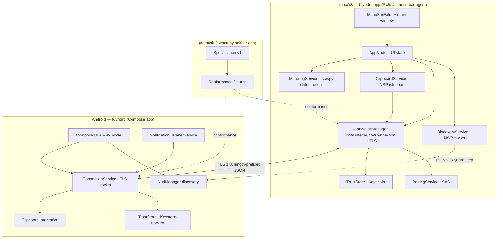
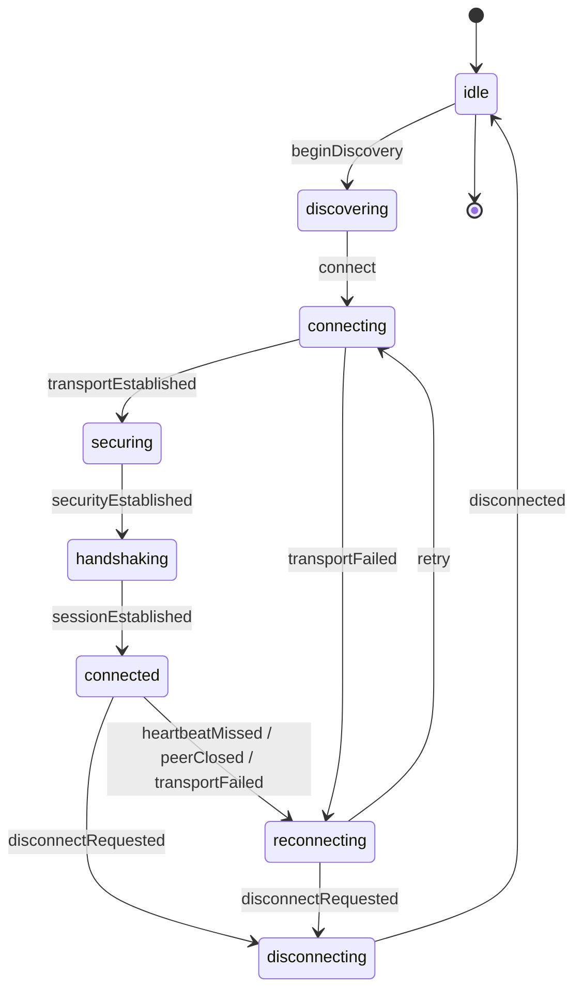

# Architecture overview

Klyndro is two native applications and one protocol. There is no shared runtime, no
generated code, and no server. This document describes the intended shape of the system
and what exists today.

## Components

## Layering rules

1. **Protocol logic is platform-independent and testable without I/O.** On macOS it lives
   in `KlyndroKit` (a SwiftPM library with its own test suite). On Android it lives in
   `protocol/` and `net/` packages covered by JVM tests. Neither side parses JSON inside a
   view.
2. **One owner per connection.** `ConnectionManager` (macOS) and `ConnectionService`
   (Android) own socket lifetime, state transitions, and reconnection. Features subscribe;
   they never create sockets.
3. **Features are additive.** Clipboard, notifications, and file transfer are message
   handlers behind the same session. Removing a feature must not change the transport.
4. **The protocol is a contract, not a library.** Both implementations are written from the
   specification. Shared JSON fixtures catch divergence — see
   [`protocol/fixtures`](../../protocol/fixtures/README.md).

## Connection lifecycle

Both platforms implement the same state machine (Swift:
`KlyndroKit/Connection/ConnectionState.swift`, Kotlin: `net/ConnectionState.kt`):

`reset` forces any state back to `idle` except `disconnecting`, where teardown is already
in flight. Reconnection uses bounded exponential backoff: 1 s, 2 s, 4 s … capped at 30 s,
±20 % jitter (`ReconnectPolicy`, unit-tested on both platforms).

Failure accounting is deliberate: a transport failure or missed heartbeat *escalates*
backoff; a clean peer close or a completed session resets it. Flapping devices therefore
back off, while a device that simply went to sleep reconnects quickly on wake.

## What exists at M1

| Component | macOS | Android |
| --- | --- | --- |
| Protocol framing + envelope | Implemented, tested | Implemented, tested |
| Connection state machine | Implemented, tested | Implemented, tested |
| Reconnect policy | Implemented, tested | Implemented, tested |
| Toolchain diagnostics | Implemented, tested, shown in UI | — (not applicable) |
| Menu bar shell + settings | Implemented, builds, launches | — |
| Compose shell (5 screens) | — | Implemented, builds |
| Device identity + self-signed certificate | Implemented, tested | Implemented, tested (JVM); Keystore path untested |
| Pin policy / trust store | Implemented, tested | Implemented, tested (in-memory + codec) |
| Mutual TLS 1.3 transport | Implemented, verified on loopback | Implemented, verified on loopback (JSSE) |
| Session handshake + heartbeat | Implemented, tested | Implemented, tested |
| Pairing window + SAS runner | Implemented, tested, wired to the UI | Protocol-level runner implemented and tested; UI/screen not built |
| Discovery (Bonjour / NSD) | Implemented; advert verified with `dns-sd` | Implemented; untested (needs a device) |
| Reconnect wiring | Policy + state machine only | Policy + state machine only |
| Clipboard / mirroring / notifications / files | Not implemented | Not implemented |

## Deliberate omissions at M1

- No dependency-injection framework, no persistence layer, no logging framework. Each would
  be guesswork before a second feature exists.
- No shared model code between platforms. Two small, independently tested implementations
  are cheaper to keep honest than a code-generation pipeline for a handful of messages.
- No App Sandbox on macOS (see ADR 0006) and no foreground service on Android yet. Both are
  decisions that must be made together with the feature that needs them. Without a service the
  Android app cannot hold a connection while backgrounded, which is why on-device connectivity
  lands in M2 alongside clipboard work.

## Related documents

- [Networking](networking.md)
- [Pairing and security](pairing-and-security.md)
- [Clipboard](clipboard.md)
- [Mirroring](mirroring.md)
- [Platform limitations](platform-limitations.md)
