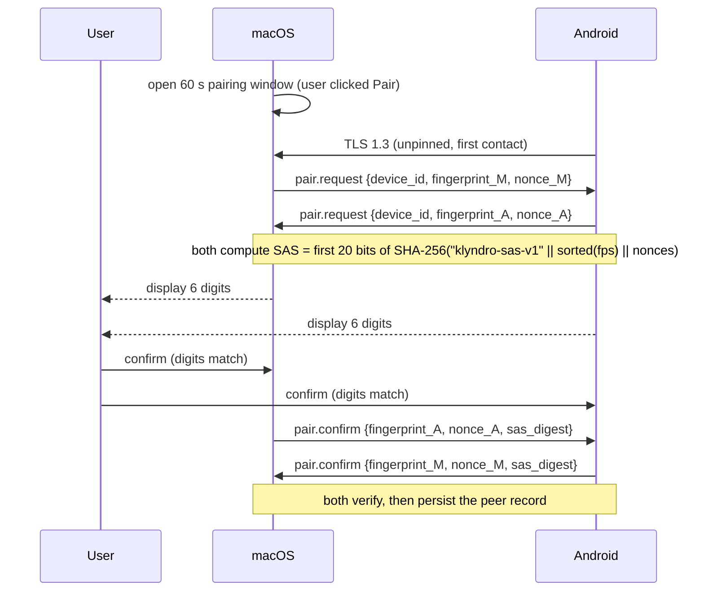

# Pairing and security model

**Status: implemented at the protocol level in M1; verified on the host with real TLS and
in-memory peers. Device-to-device pairing is BLOCKED (no Android device).**

## Assets and threats

| Asset | Threat |
| --- | --- |
| Clipboard / notification content | Passive sniffing on the LAN; a malicious device joining a session |
| Control channel (mirroring, file transfer) | Unauthenticated command injection from another device |
| Long-term device credentials | Theft from disk, backups, or logs |
| User trust decision | Impersonation during pairing (MITM) |

Explicit non-goals: defending against a compromised Mac or a rooted phone, and protecting
traffic from a network operator who can also install a root CA (certificate pinning raises
that cost but does not eliminate it).

## Trust model

- Each device generates **one long-term ECDSA P-256 key pair** on first run and stores it
  in platform secure storage (Keychain on macOS, Keystore-backed storage on Android).
- The key is published in a self-signed X.509 certificate. The certificate is not trusted
  because of who signed it — it is trusted because its **SPKI SHA-256 fingerprint** was
  confirmed by a human during pairing.
- A paired-device record is `{device_id, display_name, fingerprint, last_address, paired_at}`.
  macOS keeps it in the Keychain; Android in Keystore-encrypted storage. Losing the record
  means re-pairing; it never means "connect anyway".

## Pairing flow (SAS)

Pairing establishes the fingerprint mapping. It runs on a separate, short-lived TLS session
that is allowed to proceed *before* pinning exists, and only while a pairing window is open.

Why a comparison code instead of a typed code:

- Nothing secret is transmitted, so a passive observer learns nothing useful.
- An active MITM must terminate TLS on both sides, which yields two different
  fingerprint sets and therefore two different six-digit codes. The user sees the mismatch.
- The attacker's chance of a natural collision is 1 in 1 000 000 per attempt, and attempts
  are limited to 3 per 60 s window.

Rate limiting and lifecycle:

- One connection at a time; window closes after 60 s, on success, or after 3 failures.
- Pairing is never automatic. It requires an explicit action on both devices.
- Unpairing deletes the record and, on Android, revokes the Keystore alias.

## Reconnect authentication

No code, no prompts. Mutual TLS with a pinned fingerprint, then `hello` / `hello.ack` with a
nonce echo. A changed fingerprint is a hard failure requiring re-pairing — a device that
legitimately regenerated its key is indistinguishable from an impostor, and treating it as
one is the safe default.

## Transport rules

- TLS 1.3 only; older versions disabled on both sides. No fallback.
- No 0-RTT / early data: it is replayable, and clipboard updates are side effects.
- Alpn is not used; the protocol starts immediately after the handshake.
- Size limits are enforced before allocation (see protocol §10). A frame claiming 1 MiB is
  buffered at most to that bound; anything larger closes the connection.
- Unknown message *types* are ignored; unknown protocol *versions* close the connection.
- Every message has a unique UUID; duplicate `id` values within a session are dropped.

## Credential and secret handling

| Item | Where it lives | Never |
| --- | --- | --- |
| Private key | Keychain / Keystore (non-exportable where possible) | Files, prefs, logs, fixtures |
| Peer fingerprint | Trust store record | Logs beyond truncated form |
| Pairing digits | Memory for the duration of the window | Logs, analytics, notifications |
| Clipboard text | Memory, and the system pasteboard | Logs, database, crash reports |

Android Keystore generates non-exportable keys, so the private key never enters app memory.
If the platform cannot supply a certificate for a Keystore key, the certificate is generated
around the public key only.

## Revocation and "forget device"

- User-initiated unpair removes the record on the initiating device and sends `unpair`
  (M1 addition) so the peer drops its side too.
- If the peer is unreachable, the local record is removed immediately; the peer keeps a
  stale record until the next connection, which then fails `auth.denied` once, prompting
  the user to unpair there as well.
- No global revocation list: there is no central authority, and pretending otherwise would
  misrepresent the security properties.

## Dependencies chosen in M1

- **X.509 self-signed certificate generation.** macOS uses `swift-certificates` and signs with
  a `SecKey` from the Keychain; Android uses BouncyCastle and signs through the JCA engine. Both
  decisions, plus the Keychain storage layout and five platform findings that changed the
  design, are recorded in [ADR 0008](../decisions/0008-certificate-libraries-and-keychain.md).
- Alternative considered and rejected: application-level X25519 + HKDF + AEAD. It would
  duplicate TLS with hand-rolled composition, violating the "no custom cryptography" rule.

## What must be tested in M1

| Test | Status |
| --- | --- |
| Pairing succeeds with matching SAS | **PASS** (in-memory end-to-end on both platforms; hardware BLOCKED) |
| Pairing fails when fingerprints are swapped (MITM simulation) | **PASS** (forged-fingerprint test) |
| Pairing window expires after 60 s | **PASS** (window logic) |
| Fourth attempt within a window is refused | **PASS** (window logic) |
| Reconnect with pinned certificate succeeds | **PASS** (loopback TLS, both stacks) |
| Reconnect with mismatched certificate is refused | **PASS** (loopback TLS, both stacks) |
| Replay of `hello.ack` without matching nonce is refused | **PASS** (handshake tests) |
| Unpair blocks the peer until it re-pairs | **NOT TESTED** (needs two devices) |
